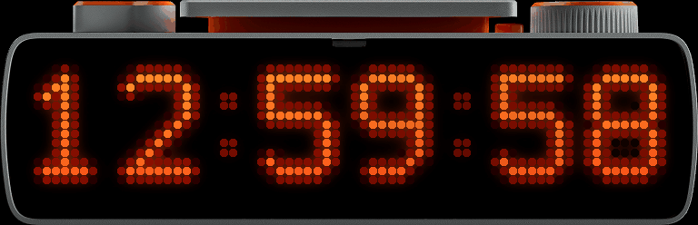

# Nixie Clock for the BUSY Bar

A nixie-tube clock for the [BUSY Bar](https://busy.app), ported to JavaScript from my [native Nixie clock](https://github.com/Negenii/busybar-nixie). Runs on the stock firmware 1.4.1 or newer.



## Install

Find **Nixie Clock** in the BUSY Apps Catalog and install it.

## Controls

On the clock, turn the wheel to change how much the tubes flickper: off, soft or strong. Press OK to switch between orange and white. Back to close the app.

Setup has the rest: flickper, colour, 12 or 24 hours, seconds on or off and the colon (steady, blinking or pulsing).

## Technical guts

A JavaScript app can't redraw the screen fast enough for a smooth glow, so all tube animations are pre-rendered. `tools/render.js` is the renderer from the native app ported to JS, `tools/bake.mjs` bakes it into `.anim` files, and the app only switches them once a second.

## Build

Only if you want to build it yourself:

```sh
npm ci
npm run build
```

The package ends up in `dist/me.negenii.nixie.tgz`.

To re-bake the animations you'd need Node, Python 3 with Pillow and `scripts/seq2anim.py` from the [BUSY Bar firmware](https://github.com/busy-app/busybar-firmware):

```sh
SEQ2ANIM=../busybar-firmware/scripts/seq2anim.py tools/bake-all.sh
```

## Credits and license

The BUSY Bar picture in `docs/` is Flipper Devices' render, used under CC-BY 4.0.

Code: MIT
